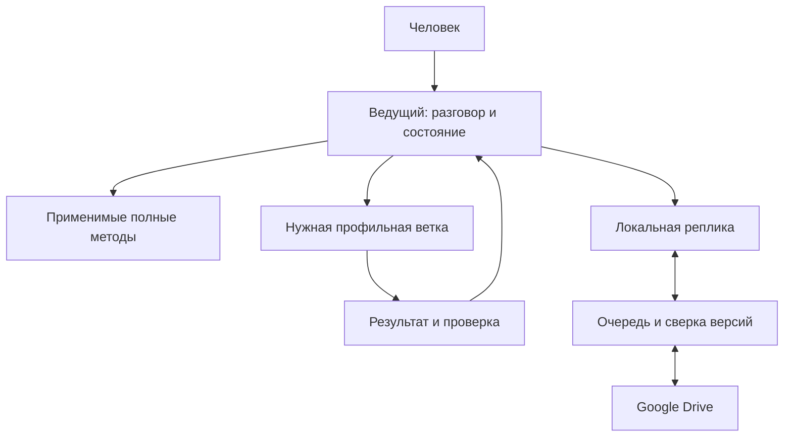

# Источник жизни

Многокомпонентная система помогает разобраться в жизненной ситуации, выбрать собственную цель и вести её по фактическим наблюдениям.

Можно работать без цели: обсуждать день, замечать повторения и возвращаться к изменениям только по своему желанию.

## Что входит

| Контур | Содержание |
|---|---|
| Общий разговор | Знакомство, деньги, отношения, здоровье и день; подробности регулярных действий, цена названной проблемы, желаемое изменение |
| Цель и план | Одна ведущая цель, приживание по необходимости, проверка принадлежности, четыре уровня раскладки, ресурсы, посильное действие и пересмотр |
| Дневник и наблюдение | Справка, отдельные дни, пропуски, уточнения, вычисления по данным и проверяемые гипотезы |
| Работа и дело | Поиск работы, отдельный работодательский найм, исследование аудитории/продукта и обучение продажам |
| Отношения | Профильная система с её режимами и границами, включая поддержку при опасности |
| Тело и зависимости | Наблюдение и поддержка выполнения, нейтральный счёт, подготовка к профильной помощи; без назначения лечения |

Полные банки вопросов и методики сохранены; ведущий загружает только нужные разделы и подключает профильных исполнителей по задаче.

## Как устроена работа



Исходные данные собираются один раз; ветка получает необходимый пакет, а не весь личный дневник и повторную анкету.

Короткий вопрос, продолжение и просьба остановиться не запускают новый полный опрос.

Проверки и ограничения конкретной ветки сохраняются, повторные управляющие циклы поверх неё не добавляются.

## Двойное хранение

Дневник предусмотрен локально и на Google Drive, по выбранным пользователем доступам и папкам.

Если Drive недоступен, разрешённая запись сохраняется локально и остаётся в очереди; система не сообщает «сохранено в обоих местах» до проверки удалённой копии.

При изменениях с двух сторон сохраняются обе версии и разрешается конфликт; слепой перезаписи и повторного создания после неизвестного результата нет.

Локальный скрипт ведёт очередь и проверяет подтверждения, а внешние действия выполняет доступный разрешённый коннектор; без него живой синхронизации нет.

Отключённое подключение в одной среде не отменяет поддержку Drive в другой.

## Файлы и запуск

- [master-prompt.md](master-prompt.md) — точка входа и карта чтения.
- [core/orchestration.md](core/orchestration.md) — роли, передача, проверка и продолжение.
- [core/storage.md](core/storage.md) — две реплики, приватность, очередь и удаление.
- [integrations/components.md](integrations/components.md) — шесть маршрутов внешних компонентов.
- [diary.md](diary.md) — шаблоны справки и дневных записей.
- [docs/setup.md](docs/setup.md) — подготовка среды и безопасное обновление.
- [docs/migration-map.md](docs/migration-map.md) — куда перенесены исходные блоки.
- [docs/verification.md](docs/verification.md) — выполненные проверки и их пределы.

Для ядра нужен проверенный аппарат из prompt-management; остальные зависимости подключаются только по выбранной ветке.

```sh
python3 scripts/components.py check --route core
python3 scripts/components.py index behavior-methodology.md --local
python3 -m unittest discover -s tests -v
```

Программа не меняет выбранную модель, не требует нового платного API и не отправляет сообщения первой.

Личные данные не входят в библиотеку; вопросы о здоровье и психологические наблюдения не превращаются в диагнозы, а самооценка не подменяет объективные данные.

Основания уточнения предметных границ — [проверка источников](docs/safety-evidence.md).
